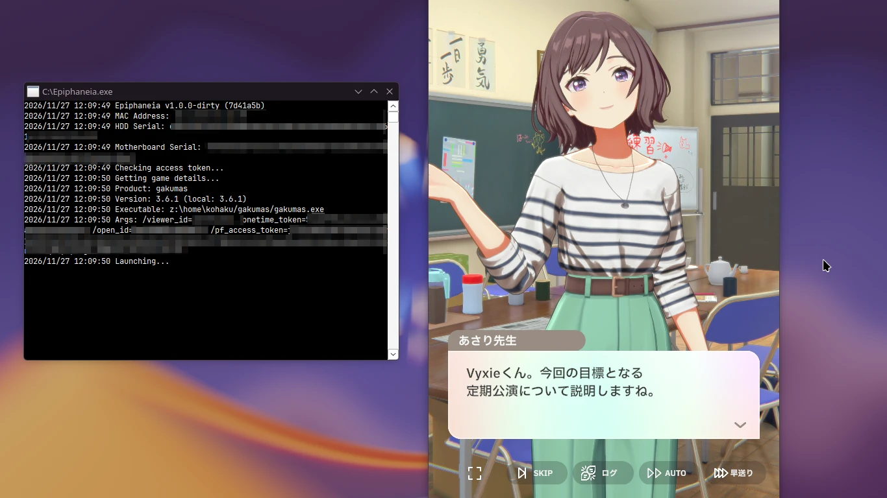
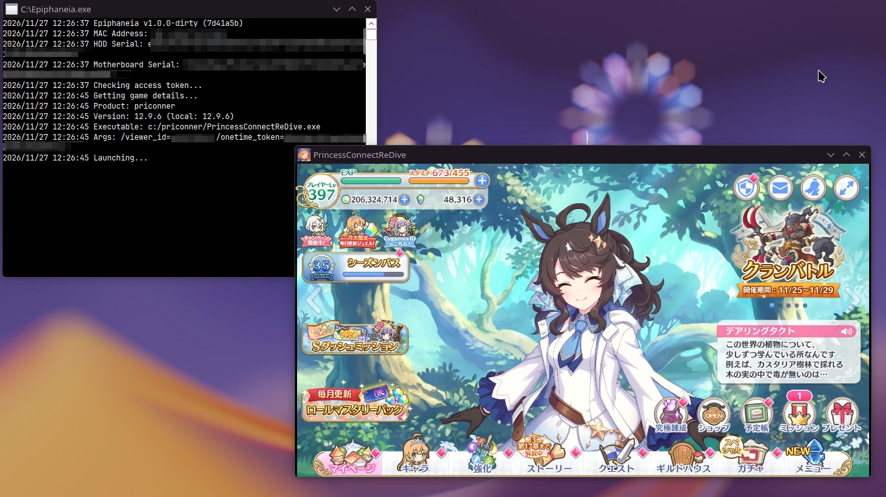

# Epiphaneia

A "simple" command-line DMM GAMES PLAYER launcher written in Go.

## :warning: Notice :warning:

You can only run games that you actually own on your DMM GAMES
account. You cannot add new free games or buy games from the library,
and must be done through the official website or client.

## Screenshots

| | |
|-|-|
|  |  |

## How to use

### Authentication (`-auth`)

To authenticate, run the program with `-auth`. A browser
should automatically open. Once authenticated, **DO NOT** open DMM GAMES
PLAYER when prompted. Enter the OAuth token into the prompt (it can
be found in the `code` parameter in the URL.)

### Game management

#### Listing owned games

To list games in your DMM GAMES library, run the program with
`-list-games`:

```text
$ ./Epiphaneia -list-games
...
List of games:
1. プリンセスコネクト！Re:Dive - priconner [INSTALLED]
2. 学園アイドルマスター - gakumas [INSTALLED]
3. ウマ娘 プリティーダービー - umamusume [INSTALLED]
```

The first one is the name of the game, and the product ID.
You will need the product ID to perform installation and
launching.

#### Installing games

To (re)install a game, run the program with `-install`. For instance,
if you want to install 学園アイドルマスター as above,
specify `gakumas` as the argument:

```sh
./Epiphaneia -install gakumas
```

By default, the game will be installed on your home folder on Linux and
`%userprofile%` on Windows. To specify a custom location, specify it
with `-install-dir`:

```sh
./Epiphaneia -install gakumas -install-dir /mnt/DMM/gakumas
```

#### Launching games

To launch a game, run the program with `-launch` along with the
product ID. To launch 学園アイドルマスター for example:

```sh
./Epiphaneia -launch gakumas
```

## Configuration

* `access_token` - specifies the access token for your DMM GAMES account.
* `mac_address` - specifies the MAC address. It is randomly generated
when new config is created.
* `motherboard_serial` - specifies the motherboard serial number in
SHA256. Randomly generated when new config is created.
* `hdd_serial` - specifies the storage serial number in SHA256.
Randomly generated when new config is created.

### Game-specific configuration

* `ignore_list`: An array containing list of files to ignore when
installing/updating. Useful for modding.
* Any other option not listed here should not be touched, unless you
know what you're doing.

### Linux only

* `proton_path` - specifies the default Proton to use. If not
specified, umu will download it's own.

#### Game-specific configuration <!-- markdownlint disable MD024 -->

* `proton_path` - override the Proton path to use for this game
* `environment` - key-value configuration for configuring the environment ariables for this game.
* `wineprefix` - override the WINEPREFIX variable. By default it lives in `$HOME/.local/share/epiphaneia/games/<product_id>`.

## Basic Troubleshooting

### Region error

Connect to a Japanese VPN to use Epiphaneia. Epiphaneia does not
bypass regional restrictions. There are services like  VPN Gate
and Mullvad VPN that can help you with that.

### Access token error

Go through the authentication process again

### Game won't launch (Linux)

If the game won't launch, then these may be the likely cause:

* Most Japanese games are protected with CrackProof. Use external
programs like [Senbei](http://github.com/Momoko-Ayase/Senbei) to unprotect them.
* The game may not work with your Proton runner. Try a different one
like proton-cachyos.
* The game relies on kernel-level anti-cheat.
* The game may simply not supported on Wine/Proton at all.

## Future plans

* FANZA GAMES support (I will need a bottle of bleach for this)

## License

Licensed under BSD 3-clause

## Disclaimer

Not affiliated with DMM.com. Use at your own risk.
